# I.O.T — Image Organization Toolkit

*Created with the partial assistance of AI*

*Creators Note* - I have long desired a program specifically tailored to quickly & efficiently organize photos and perform useful related functions. Having never found anything fit for purpose, I decided to create my own. 

A fast workflow focused all-in-one desktop tool for sorting photo collections: browse a folder of images as a thumbnail grid, then split, rename, copy, resize, de-duplicate and tag folders with bare minimum actions required. The last 20 changes are remembered and can be undone until close.

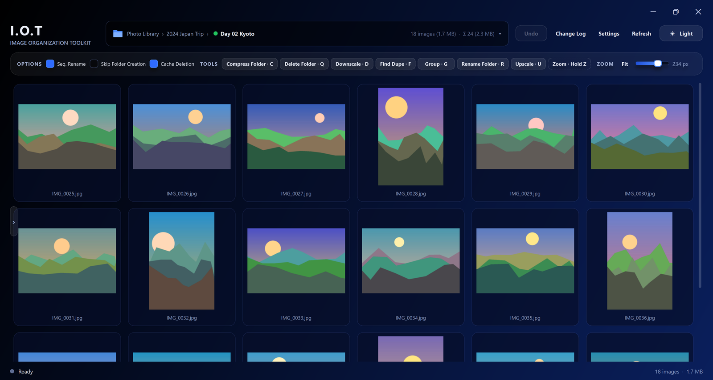

---

## Contents

- [Getting started](#getting-started)
- [The window](#the-window)
- [The folder list](#the-folder-list)
- [Sorting pictures](#sorting-pictures)
- [Tools](#tools)
- [Undo, recycle and the change log](#undo-recycle-and-the-change-log)
- [Drag and drop, and half-window mode](#drag-and-drop-and-half-window-mode)
- [Settings](#settings)
- [Keyboard and mouse reference](#keyboard-and-mouse-reference)
- [Files I.O.T creates](#files-iot-creates)
- [Thumbnail pre-cacher](#thumbnail-pre-cacher)
- [Platform notes](#platform-notes)
- [License & Disclaimer](#license--disclaimer)

---

## Getting started

**Requirements:** Python 3 (>=3.13, Install before proceeding below), [PySide6](https://pypi.org/project/PySide6/) (the Qt window toolkit) and [Pillow](https://pypi.org/project/pillow/). Drag and drop works on every platform with nothing extra to install.

```bash
pip install PySide6 pillow
```

**Optional:** [pillow-heif](https://pypi.org/project/pillow-heif/) adds HEIC / HEIF photos (the format iPhones save in). Without it everything else works; those files just aren't shown.

```bash
pip install pillow-heif
```

**Optional:** [send2trash](https://pypi.org/project/Send2Trash/) lets I.O.T send deleted files to the Recycle Bin (Trash on macOS / Linux) instead of deleting them, if you choose that in [Settings](#settings).

```bash
pip install send2trash
```

**Running it:**

```bash
python iot.pyw
```

I.O.T opens a **hub**: the top folder of the collection you want to work on. It picks the hub in this order:

1. A folder passed on the command line: `python iot.pyw "D:\Pictures\Hub"`
2. The folder it was launched from (e.g. from a file explorer custom command)
3. The folder `iot.pyw` itself is in

You can switch hubs at any time by dragging a folder onto the window (see
[Drag and drop](#drag-and-drop-and-half-window-mode)).

Supported formats: **JPEG, PNG, WebP, BMP, GIF and AVIF**, plus **HEIC / HEIF** with the optional `pillow-heif`. Animated GIFs show their first frame, and the resize tools leave them as they are (resizing would keep only the first frame).

---

## The window

- **Folder box** (top centre): where you are in the hub, the folder's tag and flags, and its image count and size. A `Σ` total is added when sub-folders hold images too. Click it to open the [folder list](#the-folder-list). The **folder button** beside it opens your computer's folder browser to pick a folder by hand; it opens the same way as a [dropped folder](#drag-and-drop-and-half-window-mode).
- **Options:** *Seq. Rename* (Sequential Rename), *Skip Folder Creation* and *Cache Deletion* (see
  [Sorting pictures](#sorting-pictures) and [Files I.O.T creates](#files-iot-creates)).
- **Tools:** the main actions, each with its keyboard shortcut.
- **Zoom:** thumbnail size slider, and **Fit**, which picks the size that fills the window width.
- **Undo / Log / Settings**, **Refresh (F5)** and a **light / dark theme** switch. Refresh picks up changes made outside I.O.T (in a file manager, say): it re-reads the folder tree and reloads the current folder without losing your place.
- **Status bar:** messages, the current range selection, and the folder's image count, size and sort order.

Right-clicking the grid opens a menu with Settings, Undo, the Change Log and Refresh, then four sub-menus (*Grid Zoom* presets, *Jump* to the top, middle or bottom (also **T**, **M**, **B**), *Sort by*, and *Tools* with every tool) and the options.

### Sort order

Pictures are shown in name order (`IMG_2` before `IMG_10`). Right-click > **Sort by** also offers **date taken** (from the camera's EXIF data; pictures without one go by their modified date), **date modified** and **size** (largest first). The choice is remembered, the status bar shows it, and range moves and renames follow the order you see. *Ignore files* (see [Settings](#settings)) always counts the first files by name, so it still skips covers at the start of a folder.

### Hover tip

The tip next to the pointer shows the picture's name, its pixel size and its file size. **Date taken** and **camera** can be added, and the file size removed, in [Settings](#settings).

The Light theme:

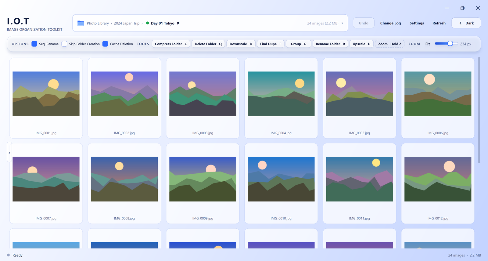

### Thumbnails

Only the thumbnails on (and just around) the screen are loaded, so folders with thousands of images open instantly and scroll smoothly. Thumbnails are cached on disk, so folders you've opened before load almost immediately. If a drive is slow to respond (a mechanical drive waking up, for example), thumbnails are retried automatically.

### Zoom preview

Hover over a picture and press **Z** for a full-screen view of it. **←** / **→** show the previous / next picture in the folder; **Z** again, **Esc** or a click closes it. The rest of the screen is frosted while the preview is open (this can be turned off in Settings).

**Double-click** a picture to open it in your computer's default image viewer (to edit it, say). The double-click doesn't select anything: the picture isn't left marked as the start of a range or as a group pick.


---

## The folder list

Click the folder box to open the folder list: every folder in the hub, as a collapsible tree.

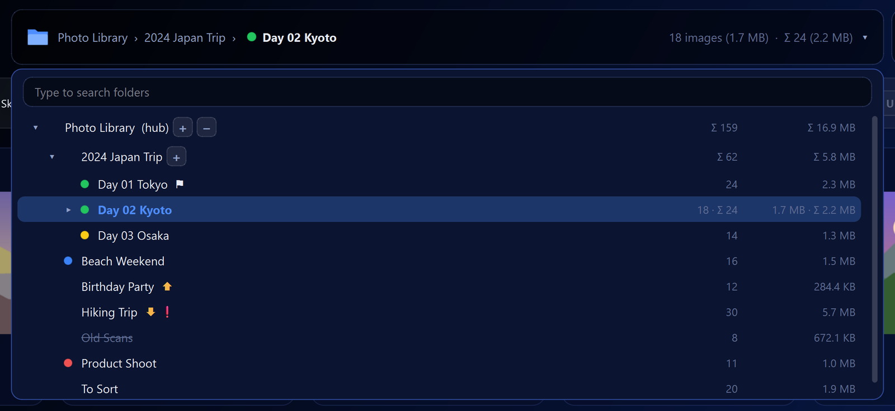

- **Counts and sizes:** each folder's image count and size, with `Σ` totals for folders that have sub-folders. Sizes can be turned off in Settings.
- **Opening:** the list opens centred on the folder you're in. Click a folder to open it, or use **W / S**
  to step through folders (folders with no images are skipped).
- **Searching:** start typing to show only the folders whose name contains it (with the folders above them, for context); **Enter** opens the first match, **Esc** clears the search. (With the pointer over a folder, **D** and **U** still resize it, so start a search with another letter or move the pointer off the list first.)
- **Expanding:** the arrow opens or closes one level. When an open folder still has closed folders inside it, a **+** button appears after its name: click it to open everything below that folder at once. When it has open folders inside it, a **−** button closes them all again, leaving just its direct sub-folders.
- **Flags** point out folders that may need attention (each can be turned off in Settings):

  | Flag | Meaning |
  |---|---|
  | 🡇 | Needs downscaling: the short edge of the folder's first picture (after any *ignored files*) is above your *Downscale* size |
  | 🡅 | Needs upscaling: that short edge is below your *Upscale* size |
  | ❗ | The folder is unusually large compared with the others (possible duplicates) |
  | ⚑ | You've changed this folder during this session |

- A folder marked for deletion with **Q** is shown ~~crossed out~~ until I.O.T closes.

### Folder tags

**Right-click** a folder in the list (or the folder box, when the list is closed) to give it a coloured tag:
handy for keeping track of which folders you've finished if you're interrupted. Pick a colour, or the
outlined circle to remove the tag.

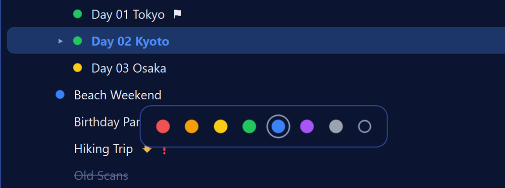

Tags are saved in the hub and follow folders you rename in I.O.T.

---

## Sorting pictures

### Move a range into a folder

**Click** the first picture of a range, then **click** the last one. You're asked for a folder name and the
range is moved into a new folder of that name inside the current folder. The name starts as the current folder's name; if the name you use ends in a number, the next suggestion counts up (`Part 01`, `Part 02`…).

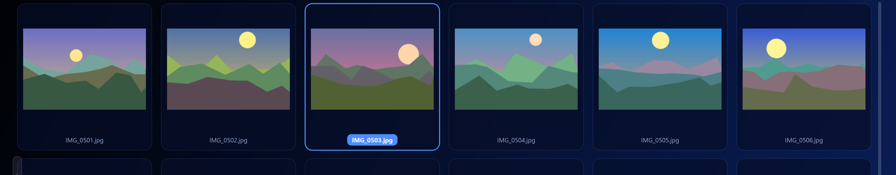

- **Sequential Rename** (*Seq. Rename* in Options, on by default) also renames the moved files `<folder name> - 01`, `- 02`, …
- **Skip Folder Creation** renames the range in place instead of moving it into a folder.
- **Into an existing folder** (optional, off by default): tick *Offer existing folders when moving a range* in [Settings](#settings) and the name box gets an **Existing Folder…** button, which lists the hub's folders (type to narrow it) and moves the range into the one you pick, names unchanged.
- **Ctrl+Click** as the second click renames the range in place straight away, using the suggested name, with no prompt (Settings > [Confirmations](#confirmations) can make it ask first).
- **Hold R and click** the last picture instead to be asked for the name first; the range is renamed in place (`<name> - 01`, `- 02`…). In group mode, hold R and click one more picture to rename every pick (and that one) the same way. With something marked, a plain tap of R only reminds you of this, so the folder isn't renamed by mistake.
- To rename whole folders at once, open the [folder list](#the-folder-list), **hover over a folder and tap Ctrl**:
  every image in that folder and all its sub-folders is renamed after its own folder (`Day 01 - 01.jpg`,`Day 01 - 02.jpg`…, in the current order) and left in place, after a confirmation. One Undo reverses it.

### Delete pictures

- **Hover + Delete** removes the picture under the pointer.
- **Click** the first picture, then **Alt+Click** the last, to delete a whole range (no confirmation, since
  Undo brings it back). The grid then scrolls so the next picture after the range is at the top.
- Neither asks first by default: Settings > [Confirmations](#confirmations) can make them ask first.
- When you've moved or deleted the last picture out of a folder, I.O.T offers to delete the empty folder when it closes (like **Q**). This can be switched off in [Settings](#settings).

### Rotate pictures

Hover over a picture and press **[** to turn it a quarter turn left, or **]** to turn it right. In group mode, every picked picture is turned. JPEGs from cameras and phones are turned without any loss of quality (only their orientation tag changes); other pictures are turned and saved again (PNG, BMP and GIF stay lossless; WebP, AVIF and HEIC are saved at the *JPEG / WebP quality* setting). Animated GIFs are left as they are. **Undo** puts the originals back.

### Group mode

Press **G** (or the **Group** button) to select any pictures, not just a range. The Group button gets an
animated border while group mode is on, and selected pictures are outlined in purple. Click a picture again to un-pick it.

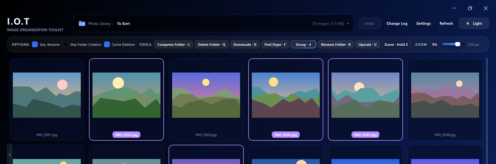

Press **Enter** to **copy** the selected pictures (names unchanged) into a new folder, suggested as
`<current folder> - Selection`. **G** or **Esc** leaves group mode.

---

## Tools

| Tool | Key | What it does |
|---|---|---|
| Compress | **C** | Makes a zip of the current folder, or of a range / group picks (see below). |
| Delete Folder | **Q** | Marks the current folder for deletion. It's deleted when I.O.T closes; until then it's crossed out, and **Q** again or **Undo** keeps it. Asks first. |
| Downscale | **D** | Shrinks images so their short edge is your *Downscale* size (only images larger than that). |
| Find Dupe | **F** | Finds every set of near-identical pictures (98%+ alike) in the folder, to keep or delete copies (see below). Greyed out where none were found. |
| Group | **G** | Group mode (see above). |
| Rename | **R** | Renames the current folder (suggests the first picture's name, after any ignored files), or a range / group picks (hold R and click, see [Sorting pictures](#sorting-pictures)). |
| Upscale | **U** | Enlarges images so their short edge is your *Upscale* size (only images smaller than that). |
| Zoom | **Hover + Z** | Full-screen preview (see above). |

### Downscale and Upscale

Before anything is changed you see a summary, including an estimate of the new resolution, worked out from the folder's first picture (after any ignored files):

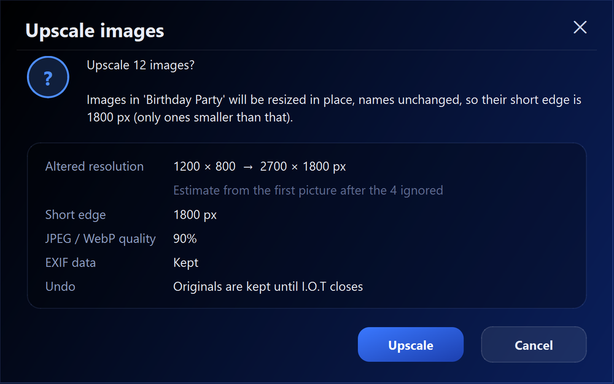

Images keep their format, colour profile and (unless you choose to strip it) their EXIF data. The originals are kept until I.O.T closes, so a resize can be undone.

To resize a whole branch at once, open the [folder list](#the-folder-list), **hover over a folder and press D or
U**: every image in that folder and all its sub-folders is resized in place, names unchanged, after the same confirmation. Folders marked for deletion are skipped, and one Undo reverses the lot.

Only the tool a folder needs is available. I.O.T looks at the short edge of the folder's first picture after any ignored files (the same check as the 🡇 / 🡅 flags): above your *Downscale* size, only **Downscale** works; below your *Upscale* size, only **Upscale**; in between (or exactly on it, with both sizes the same), both are greyed out, since there's nothing to do. The keys and the right-click menu follow the buttons. A folder with no pictures to check leaves both available. (Resizing a whole branch from the folder list isn't limited this way.)

### Find duplicates

Press **F** (or **Find Dupe**) and every picture in the folder is compared with every other; the *ignored files* at the start are skipped, since a cover or thumbnail is often a small copy of a real photo. If there are any duplicates, the **Duplicates** window opens:

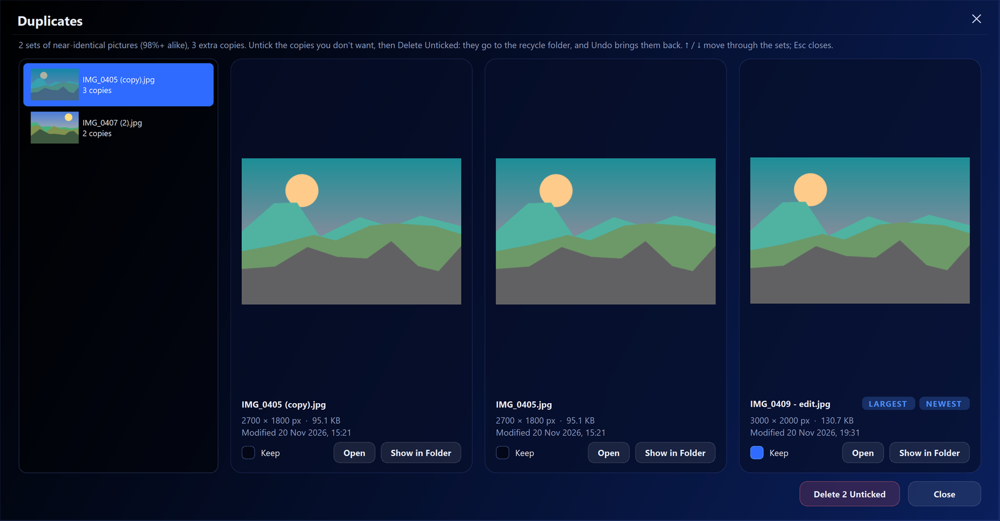

- **Left:** every set of near-identical pictures (98%+ alike), with a thumbnail and the number of copies. **↑** / **↓** move through them.
- **Right:** the chosen set side by side, each copy with its pixel size, file size and date. A copy that's clearly the **largest** or the **newest** is labelled, since that's usually what decides which one to keep.
- **Untick** the copies you don't want and press **Delete Unticked**: they go to the recycle folder like any delete, so **Undo** brings them back. A set you've sorted out leaves the list. (At least one copy has to stay ticked.)
- Click a picture (or **Open**) to see it in your image viewer; **Show in Folder** closes the window and scrolls the grid to it, outlined for a moment. **Esc** closes the window; anything you haven't dealt with is left as it is.

If a folder has no duplicates, **Find Dupe** is greyed out there, so you can see it's been checked. It's available again as soon as anything in that folder changes, or after **Refresh** (F5) — which picks up changes made outside I.O.T.

### Compress

Press **C** (or **Compress**) to make a zip of the folder you're in: the folder itself goes inside the zip, with everything in it, sub-folders included. It's named after the folder (`Day 02 Kyoto.zip`); if a zip of that name is already there, letters are taken off the end until the name is free (`Day 02 Kyot.zip`). You see what will go in and where it will be saved before anything happens, and the folder itself is never changed.

To zip **just some pictures**, mark them first, then **hold C and click the last one**:

- **A range:** click the first picture, then hold C and click the last. The zip is named after the folder and the range (`Day 02 Kyoto - IMG_0027 to IMG_0030.zip`).
- **Group mode:** pick pictures, then hold C and click one more (or one already picked). Every pick goes in (`Day 02 Kyoto - Selection.zip`).

The pictures go inside a folder named like the zip, and the zip is saved in the folder they're from. With something marked, a plain tap of C only reminds you how to zip the selection, so a whole folder isn't zipped by mistake.

A folder's zip goes next to the folder, or (for both kinds) to the folder chosen under *Compress* in [Settings](#settings). Pictures are stored as they are, since JPEG, PNG and WebP are already compressed (zipping them again would take much longer for next to no saving); other files are compressed. I.O.T's own hidden files (thumbnail cache, recycle folder, tags) are left out. **Undo** deletes the zip.

---

## Undo, recycle and the change log

- **Undo (Ctrl+Z)** reverses the last change; the **Undo** button lists the last 20 changes so you can pick one.
- Deleted pictures, and the originals of resized or rotated ones, are moved to a hidden recycle folder inside the hub rather than deleted, and are only removed when I.O.T closes. If I.O.T didn't close normally last time, you're asked what to do with anything left over.
- If you'd rather keep a safety net after closing, tick **Send deleted files to the Recycle Bin** in [Settings](#settings) (needs the optional `send2trash`). Deleted pictures then go to the Recycle Bin (Trash on macOS / Linux) from the folder they came from, so *Restore* puts them back there; an original replaced by a resize or rotate goes as `name (original).jpg`. Folders marked with **Q** go to the bin too.
- **Log** (the change log) opens a plain-text record of every change I.O.T has made, and where.

---

## Drag and drop, and half-window mode

**Drag a folder** from a File Manager onto the window to open it (or pick one with the **folder button** beside the folder box):

- A folder with sub-folders becomes the new hub.
- A folder without sub-folders opens directly if it's inside the current hub; otherwise it becomes the new hub.

The **tab on the left edge** of the grid shrinks the window to the right half of the screen (and back),
leaving room for a File Manager to drag from. In the narrower window the folder box moves onto its own row,
the toolbar wraps onto extra rows, and the tool buttons drop their key hints (hover a button to see its key) and the Zoom reminder.

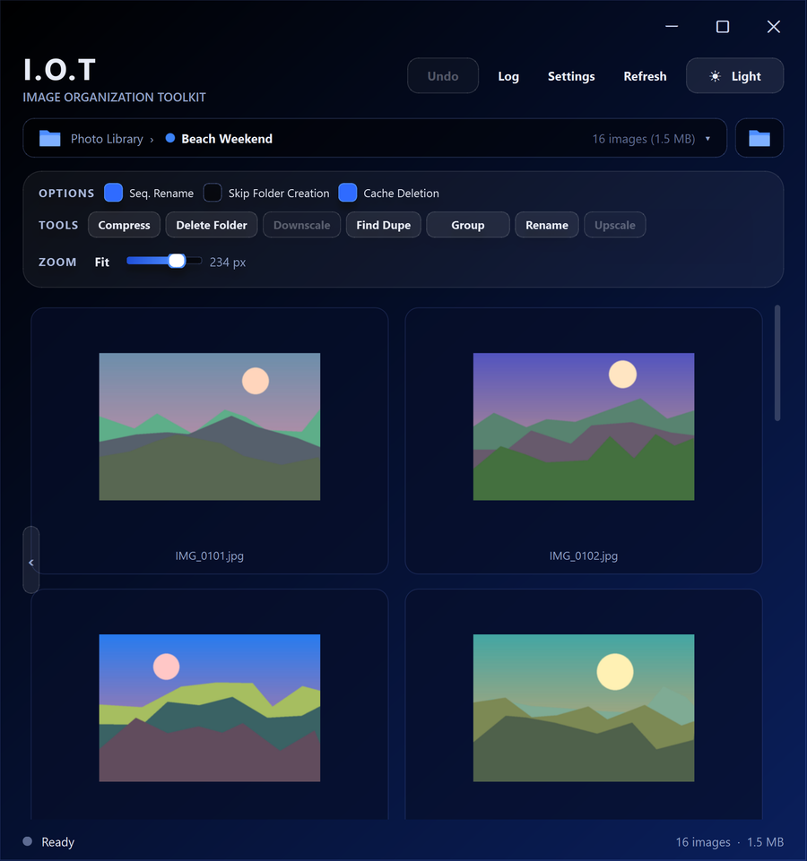

---

## Settings

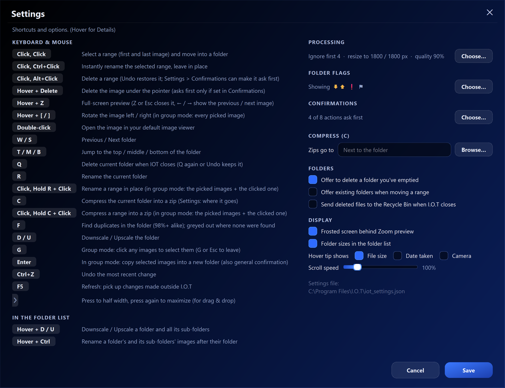

The left side lists every shortcut. On the right, **Processing**, **Folder flags** and **Confirmations** each show a one-line summary with a **Choose…** button that opens their own window; the rest are set right there. Nothing changes until you press **Save**. On a small or highly scaled screen (1080p at 125%, say) the window would be taller than the screen, so the settings scroll instead and **Save** stays in view.

**Processing** (Choose…)

| Setting                             |                                                                                                                                                                                           |
| ----------------------------------- | ----------------------------------------------------------------------------------------------------------------------------------------------------------------------------------------- |
| Ignore files                        | How many files at the start of each folder (covers, thumbnails) the resolution check, the rename suggestion, the resize estimate and Find Duplicates skip (default: 4) |
| ❗ Unusual size threshold            | A folder this far above the average size gets the ❗ flag (130 = 30% above average)                                                                                                        |
| 🡇 Downscale short edge to           | The size Downscale shrinks to (default 1800). A folder whose first picture has a longer short edge gets 🡇                                                                                 |
| 🡅 Upscale short edge to             | The size Upscale enlarges to (default 1800). A folder whose first picture has a shorter short edge gets 🡅                                                                                 |
| JPEG quality                        | Used when resizing (90 gives much smaller file sizes with no visually noticeable drop in quality)                                                                                         |
| Strip EXIF data from resized images | Removes camera model, GPS position and so on (accounts for rotation)                                                                                                                      |

**Folder flags** (Choose…): tick boxes to show or hide each flag.

**Compress:** *Zips go to*, where Compress (C) saves zips. Leave it empty to save a folder's zip next to the folder, and a selection's zip in the folder it's from.

**Folders**

| Setting | |
|---|---|
| Offer to delete a folder you've emptied | After you move or delete the last picture out of a folder, I.O.T asks whether to delete it when it closes (on by default) |
| Offer existing folders when moving a range | Adds an *Existing Folder…* button to the name box of a range move (off by default) |
| Send deleted files to the Recycle Bin | On closing, deleted files and folders go to the Recycle Bin / Trash instead of being deleted permanently (off by default; needs `send2trash`) |

**Display:** frosted Zoom background, folder sizes in the folder list, what the [hover tip](#hover-tip) shows (file size on by default; date taken and camera off), and mouse-wheel scroll speed.

### Confirmations

Not everyone wants the same workflow, so you choose which actions ask "are you sure?" first. Settings shows how many do; **Choose…** lists them, each with a tick box, plus **All on**, **All off** and **Defaults**. Changes apply when Settings is saved.

| Action | Asks first by default |
|---|---|
| Hover + Delete (one picture) | No |
| Click, Alt+Click (delete a range) | No |
| Click, Ctrl+Click (rename a range in place) | No |
| Q (delete the folder when I.O.T closes) | Yes |
| D / U (resize, also Hover + D / U in the folder list) | Yes |
| Hover + Ctrl in the folder list (rename a branch) | Yes |
| C (compress the folder) | Yes |
| Ctrl+Z (undo the latest change) | No |

The defaults keep the quick actions quick: every one of these can be undone until I.O.T closes. The name boxes (moving a range, Group copy, Rename Folder) always appear, since they ask for a name rather than a yes or no.

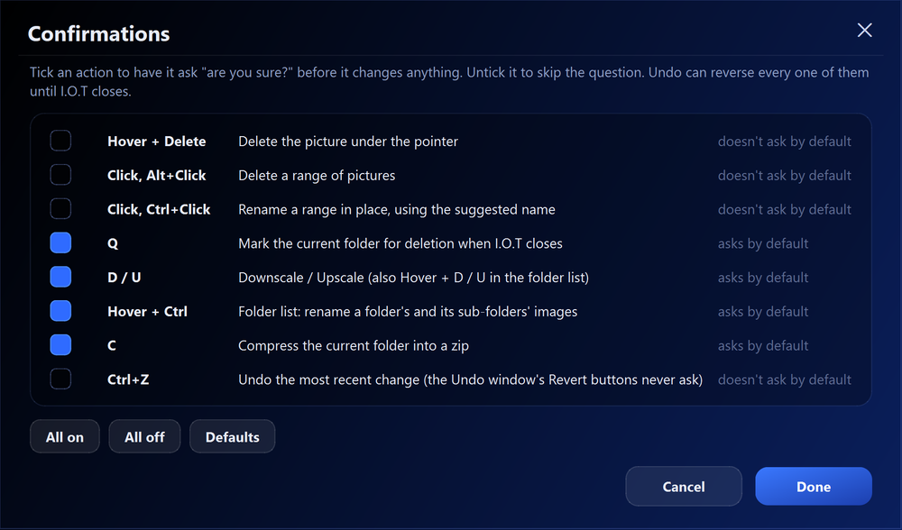

Settings are saved in `iot_settings.json` next to `iot.pyw`. If several I.O.T windows are open, each only saves the settings it changed, so they don't overwrite each other.

---

## Keyboard and mouse reference

| Keys                       | Action                                                                                             |
| -------------------------- | -------------------------------------------------------------------------------------------------- |
| Click, Click               | Select a range (first and last image) and move it into a folder                                    |
| Click, Ctrl+Click          | Rename the selected range in place, no prompt (unless set in Confirmations)                        |
| Click, Alt+Click           | Delete a range (no prompt unless set in Confirmations; Undo restores it)                           |
| Hover + Delete             | Delete the image under the pointer (no prompt unless set in Confirmations)                         |
| Hover + Z                  | Full-screen preview (Z or Esc closes it, ← / → show the previous / next image)                     |
| Hover + [ / ]              | Rotate the image left / right (in group mode: every picked image)                                  |
| Double-click               | Open the image in your default image viewer                                                        |
| W / S                      | Previous / next folder                                                                             |
| T / M / B                  | Jump to the top / middle / bottom of the folder                                                    |
| Q                          | Delete the current folder when I.O.T closes (Q again or Undo keeps it)                             |
| R                          | Rename the current folder                                                                          |
| Click, Hold R + Click      | Rename a range in place (in group mode: the picked images and the clicked one)                     |
| C                          | Compress the current folder into a zip                                                             |
| Click, Hold C + Click      | Compress a range into a zip (in group mode: the picked images and the clicked one)                 |
| F                          | Find duplicates in the folder (greyed out where none were found)                                   |
| D / U                      | Downscale / upscale the folder (only the one it needs: see Downscale and Upscale)                  |
| Folder list: Hover + D / U | Downscale / upscale a folder and all its sub-folders (used in folder list)                         |
| Folder list: Hover + Ctrl  | Rename the images in a folder and all its sub-folders after their own folder (used in folder list) |
| G                          | Group mode (G or Esc to leave)                                                                     |
| Enter                      | In group mode: copy selected images into a new folder (and general confirmation button)            |
| Ctrl+Z                     | Undo the most recent change                                                                        |
| F5                         | Refresh: pick up changes made outside I.O.T                                                        |
| Right-click a folder       | Tag it with a colour                                                                               |
| Right-click the grid       | Menu with all tools and options                                                                    |

---

## Files I.O.T creates

| Where | File | Purpose |
|---|---|---|
| Next to `iot.pyw` | `iot_settings.json` | Your settings |
| Next to `iot.pyw` | `iot_change_log.txt` | Record of every change (rotated at 5 MB) |
| In the hub (hidden) | `.thumbs_cache\` | Thumbnail cache. Deleted when I.O.T closes while *Cache Deletion* is ticked (the default); untick it to keep the cache, so folders you've opened before load faster. A kept cache is trimmed when it grows past ~3 GB |
| In the hub (hidden) | `.iot_recycle\` | Deleted pictures and resize originals, until I.O.T closes |
| In the hub (hidden) | `.iot_tags.json` | Folder tags |

| Next to `iot.pyw` | `iot_crash.log` | Only if something goes wrong: the error and your system details, to send back with a bug report |

If the folder `iot.pyw` is in can't be written to, these files go to `%APPDATA%\IOT` (Windows),
`~/Library/Application Support/IOT` (macOS) or `~/.config/IOT` (Linux) instead.

Project layout:

```
iot.pyw            the program (run this)
scripts\          its modules, and the thumbnail pre-cacher
docs\             screenshots for this README
```

---

## Thumbnail pre-cacher

`scripts\iot_precache.py` builds the thumbnail cache ahead of time (overnight, say) so even huge folders open instantly. It uses the same cache as I.O.T.

```bash
python scripts\iot_precache.py "D:\Pictures\Hub"
```

Options: `--workers N`, `--clean-old`, `--no-pause` (for Task Scheduler) and `--normal-priority` (it runs at low priority by default). It can be stopped at any time and carries on where it left off next time. Untick *Cache Deletion* in I.O.T first, or the cache is deleted when I.O.T closes.

---

## Platform notes

I.O.T is developed and tested on **Windows 10/11**, and runs on **Linux** and **macOS** from the same files. Linux and macOS support is new, and macOS relies on user feedback: if something misbehaves, please send `iot_crash.log` (see [Files I.O.T creates](#files-iot-creates)) along with what you were doing.

**macOS**

- Shortcuts follow Mac conventions: **Cmd** wherever Windows uses Ctrl (Click, **Cmd+Click** to rename a range, **Cmd+Z** to undo, **Hover + Cmd** in the folder list) and **Option** for Alt (Click, **Option+Click** to delete a range). Settings shows the Mac names.
- Right-click (or Ctrl+Click) opens the menus. The **delete** key (Backspace) deletes the picture under the pointer.
- The frosted background behind the Zoom preview needs **Screen Recording** permission (System Settings → Privacy & Security). Without it you just see the desktop picture behind the preview; it can be turned off in Settings.

**Linux**

- Some window managers use **Alt+drag** to move windows, which stops Alt+Click reaching I.O.T. If range delete doesn't respond, change that window-manager shortcut (often to the Super key).
- The frosted Zoom background works on X11; on Wayland the preview opens without it.
- Folder flags use plain symbols (! ⚑, and ⬇ ⬆ for the resize flags) instead of colour emoji, which aren't installed on every Linux desktop.
- The hidden-file attribute is a Windows feature; elsewhere I.O.T's own files are hidden by their names starting with a dot.

## License & Disclaimer

Copyright 2026 Santaros4

This project is licensed under the Apache License 2.0 — see the [LICENSE](LICENSE) file for details.

**Data Safety Notice:** This toolkit modifies, moves, or deletes files on your storage drive. While tested, software bugs or unexpected file formats can cause data loss. Always back up your photo library before running bulk operations, and try new features on a sample folder first. I.O.T's own safeguards (confirmations, [Undo](#undo-recycle-and-the-change-log), and deleted files only being removed when I.O.T closes) help, but they are not a substitute for a backup. The authors are not responsible for any lost, corrupted, or overwritten files.

I.O.T is provided "as is", without warranties or conditions of any kind; see sections 7 (Disclaimer of Warranty) and 8 (Limitation of Liability) of the [LICENSE](LICENSE).
