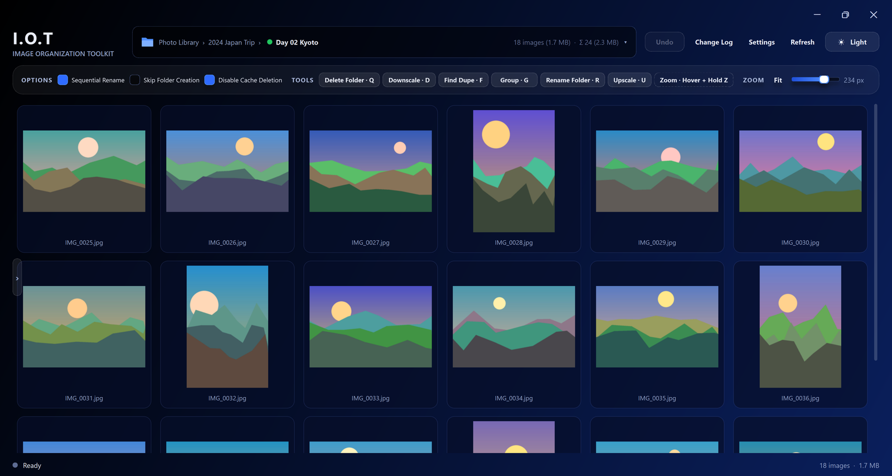
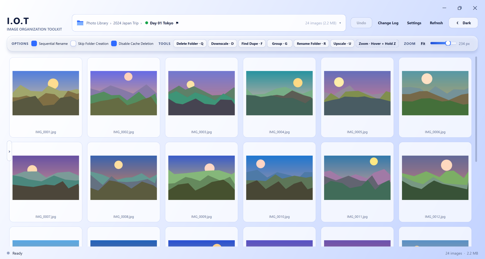
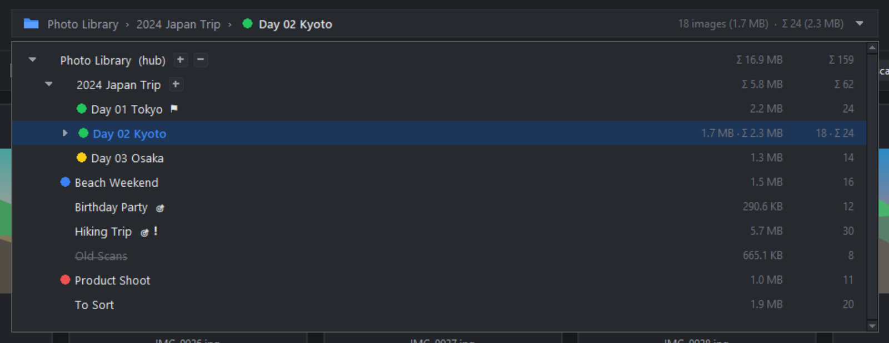
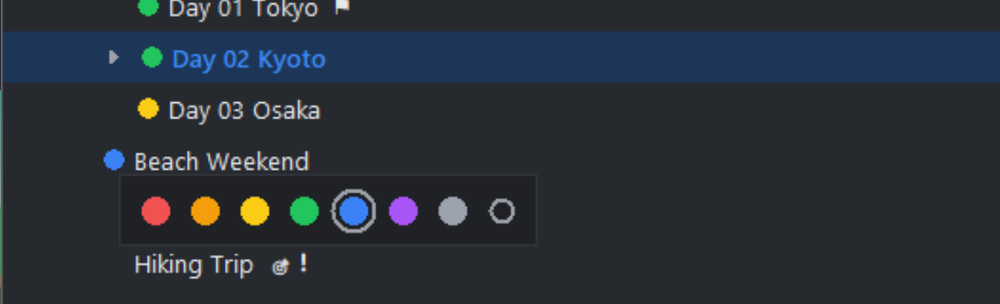
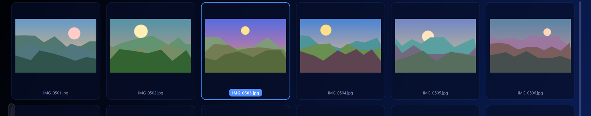
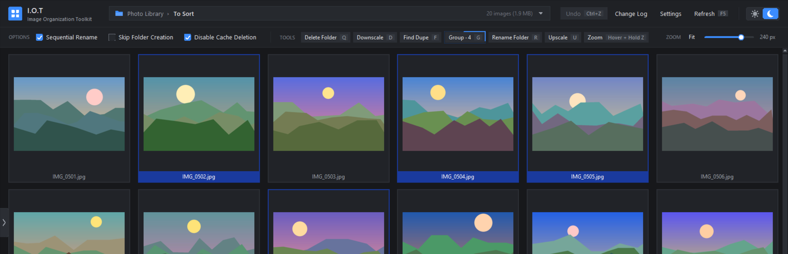
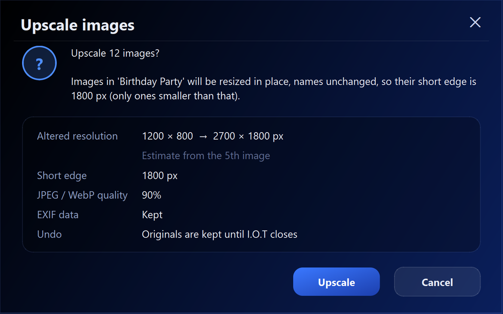
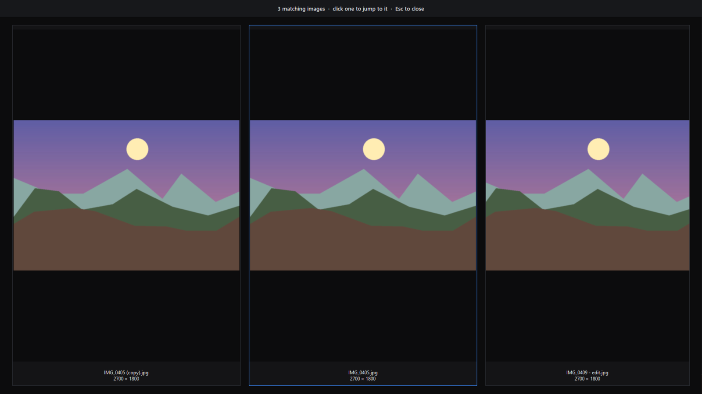
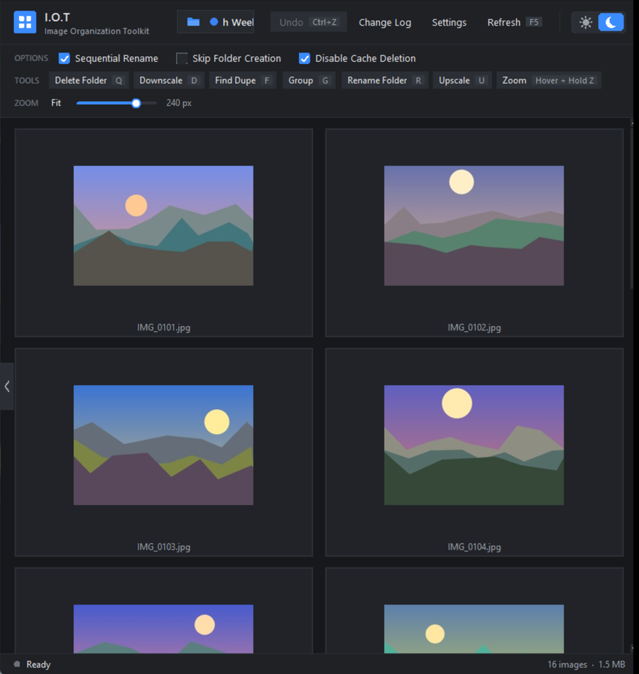
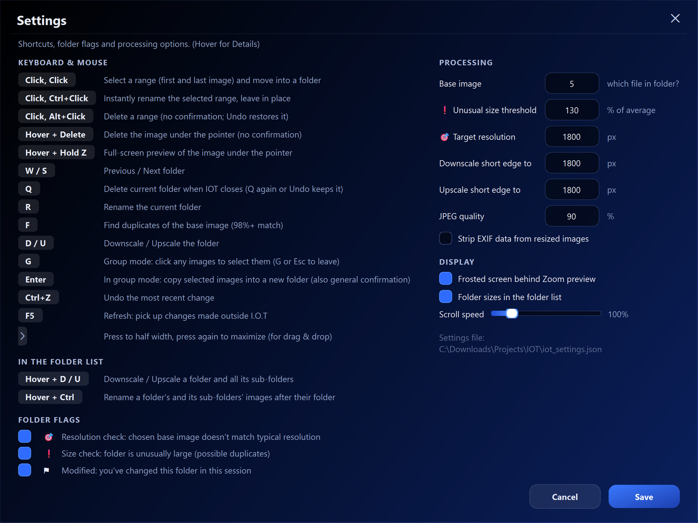

# I.O.T — Image Organization Toolkit

*Created with the partial assistance of AI*

*Creators Note* - I have long desired a program specifically tailored to quickly & efficiently organize photos and perform useful related functions. Having never found anything fit for purpose, I decided to create my own. 

A fast workflow focused all-in-one desktop tool for sorting photo collections: browse a folder of images as a thumbnail grid, then split, rename, copy, resize, de-duplicate and tag folders with bare minimum actions required. The last 20 changes are remembered and can be undone until close.



---

## Contents

- [Getting started](#getting-started)
- [The window](#the-window)
- [The folder list](#the-folder-list)
- [Sorting pictures](#sorting-pictures)
- [Tools](#tools)
- [Undo, recycle and the change log](#undo-recycle-and-the-change-log)
- [Drag and drop, and half-window mode](#drag-and-drop-and-half-window-mode)
- [Settings](#settings)
- [Keyboard and mouse reference](#keyboard-and-mouse-reference)
- [Files I.O.T creates](#files-iot-creates)
- [Thumbnail pre-cacher](#thumbnail-pre-cacher)
- [Platform notes](#platform-notes)
- [License & Disclaimer](#license--disclaimer)

---

## Getting started

**Requirements:** Python 3 (developed on 3.13) and [Pillow](https://pypi.org/project/pillow/).

```bash
pip install pillow
```

**Tkinter** (the window toolkit) comes with Python on Windows and with the python.org installer on macOS, so there's nothing to install there. On Linux it's often a separate system package:

```bash
sudo apt install python3-tk        # Debian / Ubuntu / Mint
sudo dnf install python3-tkinter   # Fedora
sudo pacman -S tk                  # Arch
```

**Optional, macOS / Linux only:** [tkinterdnd2](https://pypi.org/project/tkinterdnd2/) adds [drag and drop](#drag-and-drop-and-half-window-mode) (dragging a folder from your file manager onto the window to open it). Windows has this built in. Without it everything else works normally.

```bash
pip install tkinterdnd2
```

**Running it:**

```bash
python iot.py
```

I.O.T opens a **hub**: the top folder of the collection you want to work on. It picks the hub in this order:

1. A folder passed on the command line: `python iot.py "D:\Pictures\Hub"`
2. The folder it was launched from (e.g. from a file explorer custom command)
3. The folder `iot.py` itself is in

You can switch hubs at any time by dragging a folder onto the window (see
[Drag and drop](#drag-and-drop-and-half-window-mode)).

Supported formats: **JPEG, PNG, WebP and BMP**.

---

## The window

- **Folder box** (top centre): where you are in the hub, the folder's tag and flags, and its image count and size. A `Σ` total is added when sub-folders hold images too. Click it to open the [folder list](#the-folder-list).
- **Options:** *Sequential Rename*, *Skip Folder Creation* and *Disable Cache Deletion* (see
  [Sorting pictures](#sorting-pictures) and [Files I.O.T creates](#files-iot-creates)).
- **Tools:** the main actions, each with its keyboard shortcut.
- **Zoom:** thumbnail size slider, and **Fit**, which picks the size that fills the window width.
- **Undo / Change Log / Settings**, **Refresh (F5)** and a **light / dark theme** switch. Refresh picks up changes made outside I.O.T (in a file manager, say): it re-reads the folder tree and reloads the current folder without losing your place.
- **Status bar:** messages, the current range selection, and the folder's image count and size.

Right-clicking the grid opens a menu with the same tools, the options, *Jump to Top / Middle / Bottom* and grid zoom presets.

The Light theme:



### Thumbnails

Only the thumbnails on (and just around) the screen are loaded, so folders with thousands of images open instantly and scroll smoothly. Thumbnails are cached on disk, so folders you've opened before load almost immediately. If a drive is slow to respond (a mechanical drive waking up, for example), thumbnails are retried automatically.

### Zoom preview

Hover over a picture and **hold Z** for a full-screen view of it. Let go to return. The rest of the screen is frosted while the preview is open (this can be turned off in Settings).


---

## The folder list

Click the folder box to open the folder list: every folder in the hub, as a collapsible tree.



- **Counts and sizes:** each folder's image count and size, with `Σ` totals for folders that have sub-folders. Sizes can be turned off in Settings.
- **Opening:** the list opens centred on the folder you're in. Click a folder to open it, or use **W / S**
  to step through folders (folders with no images are skipped).
- **Expanding:** the arrow opens or closes one level. When an open folder still has closed folders inside it, a **+** button appears after its name: click it to open everything below that folder at once. When it has open folders inside it, a **−** button closes them all again, leaving just its direct sub-folders.
- **Flags** point out folders that may need attention (each can be turned off in Settings):

  | Flag | Meaning |
  |---|---|
  | 🎯 | The *chosen base image* doesn't match your typical resolution |
  | ❗ | The folder is unusually large compared with the others (possible duplicates) |
  | ⚑ | You've changed this folder during this session |

- A folder marked for deletion with **Q** is shown ~~crossed out~~ until I.O.T closes.

### Folder tags

**Right-click** a folder in the list (or the folder box, when the list is closed) to give it a coloured tag:
handy for keeping track of which folders you've finished if you're interrupted. Pick a colour, or the
outlined circle to remove the tag.



Tags are saved in the hub and follow folders you rename in I.O.T.

---

## Sorting pictures

### Move a range into a folder

**Click** the first picture of a range, then **click** the last one. You're asked for a folder name and the
range is moved into a new folder of that name inside the current folder. The name starts as the current folder's name; if the name you use ends in a number, the next suggestion counts up (`Part 01`, `Part 02`…).



- **Sequential Rename** (on by default) also renames the moved files `<folder name> - 01`, `- 02`, …
- **Skip Folder Creation** renames the range in place instead of moving it into a folder.
- **Ctrl+Click** as the second click renames the range in place straight away, using the suggested name, with no prompt.
- To rename whole folders at once, open the [folder list](#the-folder-list), **hover over a folder and tap Ctrl**:
  every image in that folder and all its sub-folders is renamed after its own folder (`Day 01 - 01.jpg`,`Day 01 - 02.jpg`…, in the current order) and left in place, after a confirmation. One Undo reverses it.

### Delete pictures

- **Hover + Delete** removes the picture under the pointer.
- **Click** the first picture, then **Alt+Click** the last, to delete a whole range (no confirmation, since
  Undo brings it back). The grid then scrolls so the next picture after the range is at the top.

### Group mode

Press **G** (or the **Group** button) to select any pictures, not just a range. The Group button gets an
animated border while group mode is on, and selected pictures are outlined in dark blue. Click a picture again to un-pick it.



Press **Enter** to **copy** the selected pictures (names unchanged) into a new folder, suggested as
`<current folder> - Selection`. **G** or **Esc** leaves group mode.

---

## Tools

| Tool | Key | What it does |
|---|---|---|
| Delete Folder | **Q** | Marks the current folder for deletion. It's deleted when I.O.T closes; until then it's crossed out, and **Q** again or **Undo** keeps it. Asks first. |
| Downscale | **D** | Shrinks images so their short edge is your *Downscale* size (only images larger than that). |
| Find Dupe | **F** | Finds near-identical copies (98%+ match) of the folder's base image. |
| Group | **G** | Group mode (see above). |
| Rename Folder | **R** | Renames the current folder (suggests the base image's name). |
| Upscale | **U** | Enlarges images so their short edge is your *Upscale* size (only images smaller than that). |
| Zoom | **Hover + Hold Z** | Full-screen preview (see above). |

### Downscale and Upscale

Before anything is changed you see a summary, including an estimate of the new resolution based on the chosen base image:



Images keep their format, colour profile and (unless you choose to strip it) their EXIF data. The originals are kept until I.O.T closes, so a resize can be undone.

To resize a whole branch at once, open the [folder list](#the-folder-list), **hover over a folder and press D or
U**: every image in that folder and all its sub-folders is resized in place, names unchanged, after the same confirmation. Folders marked for deletion are skipped, and one Undo reverses the lot.

### Find duplicates

Every image in the folder is compared with the base image, and any matches are shown side by side. Click one to jump to it in the grid view.



---

## Undo, recycle and the change log

- **Undo (Ctrl+Z)** reverses the last change; the **Undo** button lists the last 20 changes so you can pick one.
- Deleted pictures, and the originals of resized ones, are moved to a hidden recycle folder inside the hub rather than deleted, and are only removed when I.O.T closes. If I.O.T didn't close normally last time, you're asked what to do with anything left over.
- **Change Log** opens a plain-text record of every change I.O.T has made, and where.

---

## Drag and drop, and half-window mode

**Drag a folder** from a File Manager onto the window to open it:

- A folder with sub-folders becomes the new hub.
- A folder without sub-folders opens directly if it's inside the current hub; otherwise it becomes the new hub.

The **tab on the left edge** of the grid shrinks the window to the right half of the screen (and back),
leaving room for a File Manager to drag from. The toolbar wraps onto extra rows to fit.



---

## Settings



**Processing**

| Setting                             |                                                                                                                                                                                           |
| ----------------------------------- | ----------------------------------------------------------------------------------------------------------------------------------------------------------------------------------------- |
| Base image                          | Which picture in a folder is used for checks and suggestions (default: the 5th), so images you don't want those based on (i.e. covers or thumbnails) at the start of a folder are skipped |
| ❗ Unusual size threshold            | A folder this far above the average size gets the ❗ flag (130 = 30% above average)                                                                                                        |
| 🎯 Target resolution                | The short-edge resolution your folders should have (defaults to 1800, i.e. Length or Width must be at least)                                                                              |
| Downscale / Upscale short edge to   | The sizes the resize tools aim for (see Target resolution)                                                                                                                                |
| JPEG quality                        | Used when resizing (90 gives much smaller file sizes with no visually noticeable drop in quality)                                                                                         |
| Strip EXIF data from resized images | Removes camera model, GPS position and so on (accounts for rotation)                                                                                                                      |

**Display:** frosted Zoom background, folder sizes in the folder list, and mouse-wheel scroll speed.

**Folder flags:** tick boxes to show or hide each flag.

Settings are saved in `iot_settings.json` next to `iot.py`. If several I.O.T windows are open, each only saves the settings it changed, so they don't overwrite each other.

---

## Keyboard and mouse reference

| Keys                       | Action                                                                                             |
| -------------------------- | -------------------------------------------------------------------------------------------------- |
| Click, Click               | Select a range (first and last image) and move it into a folder                                    |
| Click, Ctrl+Click          | Rename the selected range in place, no prompt                                                      |
| Click, Alt+Click           | Delete a range (no prompt, Undo restores it)                                                       |
| Hover + Delete             | Delete the image under the pointer (no prompt)                                                     |
| Hover + Hold Z             | Full-screen preview of the image under the pointer                                                 |
| W / S                      | Previous / next folder                                                                             |
| Q                          | Delete the current folder when I.O.T closes (Q again or Undo keeps it)                             |
| R                          | Rename the current folder                                                                          |
| F                          | Find duplicates of the base image                                                                  |
| D / U                      | Downscale / upscale the folder                                                                     |
| Folder list: Hover + D / U | Downscale / upscale a folder and all its sub-folders (used in folder list)                         |
| Folder list: Hover + Ctrl  | Rename the images in a folder and all its sub-folders after their own folder (used in folder list) |
| G                          | Group mode (G or Esc to leave)                                                                     |
| Enter                      | In group mode: copy selected images into a new folder (and general confirmation button)            |
| Ctrl+Z                     | Undo the most recent change                                                                        |
| F5                         | Refresh: pick up changes made outside I.O.T                                                        |
| Right-click a folder       | Tag it with a colour                                                                               |
| Right-click the grid       | Menu with all tools and options                                                                    |

---

## Files I.O.T creates

| Where | File | Purpose |
|---|---|---|
| Next to `iot.py` | `iot_settings.json` | Your settings |
| Next to `iot.py` | `iot_change_log.txt` | Record of every change (rotated at 5 MB) |
| In the hub (hidden) | `.thumbs_cache\` | Thumbnail cache. Deleted when I.O.T closes unless *Disable Cache Deletion* is ticked (the default); trimmed when it grows past ~3 GB |
| In the hub (hidden) | `.iot_recycle\` | Deleted pictures and resize originals, until I.O.T closes |
| In the hub (hidden) | `.iot_tags.json` | Folder tags |

| Next to `iot.py` | `iot_crash.log` | Only if something goes wrong: the error and your system details, to send back with a bug report |

If the folder `iot.py` is in can't be written to, these files go to `%APPDATA%\IOT` (Windows),
`~/Library/Application Support/IOT` (macOS) or `~/.config/IOT` (Linux) instead.

Project layout:

```
iot.py            the program (run this)
scripts\          its modules, and the thumbnail pre-cacher
docs\             screenshots for this README
```

---

## Thumbnail pre-cacher

`scripts\iot_precache.py` builds the thumbnail cache ahead of time (overnight, say) so even huge folders open instantly. It uses the same cache as I.O.T.

```bash
python scripts\iot_precache.py "D:\Pictures\Hub"
```

Options: `--workers N`, `--clean-old`, `--no-pause` (for Task Scheduler) and `--normal-priority` (it runs at low priority by default). It can be stopped at any time and carries on where it left off next time. Keep *Disable Cache Deletion* ticked in I.O.T, or the cache is deleted when I.O.T closes.

---

## Platform notes

I.O.T is developed and tested on **Windows 10/11**, and runs on **Linux** and **macOS** from the same files. Linux and macOS support is new, and macOS relies on user feedback: if something misbehaves, please send `iot_crash.log` (see [Files I.O.T creates](#files-iot-creates)) along with what you were doing.

**macOS**

- Shortcuts follow Mac conventions: **Cmd** wherever Windows uses Ctrl (Click, **Cmd+Click** to rename a range, **Cmd+Z** to undo, **Hover + Cmd** in the folder list) and **Option** for Alt (Click, **Option+Click** to delete a range). Settings shows the Mac names.
- Right-click (or Ctrl+Click) opens the menus. The **delete** key (Backspace) deletes the picture under the pointer.
- The frosted background behind the Zoom preview needs **Screen Recording** permission (System Settings → Privacy & Security). Without it you just see the desktop picture behind the preview; it can be turned off in Settings.
- Drag and drop needs the optional `tkinterdnd2` package.

**Linux**

- Drag and drop needs the optional `tkinterdnd2` package.
- Some window managers use **Alt+drag** to move windows, which stops Alt+Click reaching I.O.T. If range delete doesn't respond, change that window-manager shortcut (often to the Super key).
- The frosted Zoom background works on X11; on Wayland the preview opens without it.
- Folder flags use plain symbols (◎ ! ⚑) instead of colour emoji, which can crash Tk on Linux.
- The themed title bar and the hidden-file attribute are Windows features; elsewhere I.O.T's own files are hidden by their names starting with a dot.

## License & Disclaimer

Copyright 2026 Santaros4

This project is licensed under the Apache License 2.0 — see the [LICENSE](LICENSE) file for details.

**Data Safety Notice:** This toolkit modifies, moves, or deletes files on your storage drive. While tested, software bugs or unexpected file formats can cause data loss. Always back up your photo library before running bulk operations, and try new features on a sample folder first. I.O.T's own safeguards (confirmations, [Undo](#undo-recycle-and-the-change-log), and deleted files only being removed when I.O.T closes) help, but they are not a substitute for a backup. The authors are not responsible for any lost, corrupted, or overwritten files.

I.O.T is provided "as is", without warranties or conditions of any kind; see sections 7 (Disclaimer of Warranty) and 8 (Limitation of Liability) of the [LICENSE](LICENSE).
